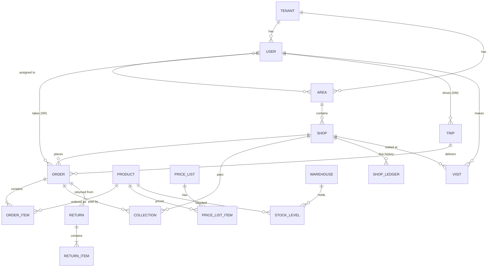

# Onukrom — Sales & Delivery Field App

**Build specification** · Laravel admin panel (Inertia + React) + API · Native Android app (sales reps and delivery men only)
Version 1.2 · 2026-11-10

> The goal is simple: a sales rep should be able to walk into a shop, find it, tap in the products, and save the order **in under a minute, even with no internet**. Everything else in this document supports that goal.

### What changed in v1.1 – v1.2

| Topic            | Decision                                                                                                                                                                                                           |
| ---------------- | ------------------------------------------------------------------------------------------------------------------------------------------------------------------------------------------------------------------ |
| Company slug     | The slug is only a **company code** assigned to each company. **No subdomains** — everything runs on one domain.                                                                                                   |
| Staff login      | Owner invites a phone number → the system **auto-generates a password** and sends it **by SMS**. Staff log in with company code + phone + password and can **change the password later** in the app. No OTP login. |
| SMS provider     | **Alpha SMS** (only driver for now, behind an `SmsGateway` interface).                                                                                                                                             |
| Mobile app       | **Only for SR (Sales Rep) and DM (Delivery Man).** Owner and managers use the web admin panel.                                                                                                                     |
| Branding         | **No tenant logo or branding in the app.** The app name is our company name (**Onukrom**).                                                                                                                         |
| Admin panel      | **Laravel + Inertia 2 + React (TypeScript)**.                                                                                                                                                                      |
| Hosting          | **cPanel** shared/reseller hosting to start. **No Redis** (database queue & cache).                                                                                                                                |
| Realtime         | **Not needed for now** — no Reverb / websockets.                                                                                                                                                                   |
| Shops & products | Shop list and product list are **saved on the phone and updated automatically** so order creation is always fast (section 7.10).                                                                                   |
| Design           | **Flat UI** for both the admin panel and the app (section 15).                                                                                                                                                     |
| Order location   | **v1.2:** the app collects the SR's **live location** while an order is being taken, and every order is saved with a fresh GPS fix (section 10.5). The same applies to deliveries and payment collection.          |
| Admin language   | **v1.2:** admin panel in **Bangla (default) and English** with a switcher (react-i18next + Laravel `lang/bn`).                                                                                                     |

---

## Table of contents

1. [Overview & glossary](#1-overview--glossary)
2. [Tech stack](#2-tech-stack)
3. [Multi-tenancy & company selection](#3-multi-tenancy--company-selection)
4. [Invitations, password login & devices](#4-invitations-password-login--devices)
5. [Roles & permissions](#5-roles--permissions)
6. [Data model](#6-data-model)
7. [Offline-first sync](#7-offline-first-sync-the-core)
8. [Sales rep app flows](#8-sales-rep-app-flows)
9. [Delivery man app flows](#9-delivery-man-app-flows)
10. [Payments & dues, stock, returns, GPS](#10-payments--dues-stock-returns-gps)
11. [Admin panel (Inertia + React)](#11-admin-panel-inertia--react)
12. [API contract](#12-api-contract)
13. [Security](#13-security)
14. [Performance & UX rules](#14-performance--ux-rules)
15. [Visual design: flat UI](#15-visual-design-flat-ui)
16. [Project structure](#16-project-structure)
17. [Roadmap & acceptance criteria](#17-roadmap--acceptance-criteria)
18. [Testing checklist](#18-testing-checklist)
19. [Appendix: JSON examples](#appendix-a-json-examples)

---

## 1. Overview & glossary

Onukrom is a **multi-tenant SaaS** for distributors and companies that sell to retail shops through field staff.

- Each company (tenant) is assigned a **slug** — a short **company code** such as `rahimtraders`. It is **not** a subdomain: all companies use the same domain, and the code only tells the system which company a login belongs to.
- The **owner** manages everything in a web admin panel: staff, roles, shops, products, prices, stock, orders, deliveries, payments, reports.
- **One Android app** is used **only** by **sales reps** (take orders) and **delivery men** (deliver orders, collect money). What a person sees depends on the permissions the owner gave them. Owners and managers work in the web admin panel, not the app.
- Staff cannot sign up. The owner invites a phone number; the system generates a password and sends it by SMS (Alpha SMS). The staff member logs in with company code + phone + password and can change the password later.
- The app has **no company logo or per-company branding**. It is named after our company — **Onukrom** — for everyone.
- The app works **offline-first**: everything is saved on the phone at once and synced automatically when the network comes back. The shop list and product list are kept on the phone and refreshed automatically, so taking an order never waits for the network.

| Term                  | Meaning                                                                                           |
| --------------------- | ------------------------------------------------------------------------------------------------- |
| **Tenant / Company**  | A business using Onukrom. Identified by its `slug` (the **company code**; not a subdomain).       |
| **Owner**             | Tenant super user. Created when the company signs up. Cannot be removed by others.                |
| **Manager**           | Office staff with broad access (approve orders, assign deliveries, see reports).                  |
| **SR (Sales Rep)**    | Field staff who visits shops and takes orders.                                                    |
| **DM (Delivery Man)** | Field staff who delivers orders and collects payments.                                            |
| **Shop / Outlet**     | A retail customer. Belongs to one area/route.                                                     |
| **Area / Route**      | A group of shops visited together (e.g. "Mirpur-10 Saturday route"). Staff are assigned to areas. |
| **Order**             | What the SR takes at the shop. Becomes an invoice when delivered.                                 |
| **Trip (Load)**       | A set of orders given to one DM for one run, with a load sheet of total products.                 |
| **Collection**        | Money received from a shop (cash, bKash, Nagad, bank, cheque).                                    |
| **Due**               | What a shop still owes (shop ledger balance).                                                     |
| **Visit**             | An SR's check-in at a shop, with or without an order (with a "no order" reason).                  |
| **Outbox**            | Local queue on the phone of records waiting to be uploaded.                                       |

---

## 2. Tech stack

### 2.1 Backend & admin panel

| Piece                    | Choice                                                                                                                                                                                                                                                                                 | Why                                                                                                                                                                                                      |
| ------------------------ | -------------------------------------------------------------------------------------------------------------------------------------------------------------------------------------------------------------------------------------------------------------------------------------- | -------------------------------------------------------------------------------------------------------------------------------------------------------------------------------------------------------- |
| Framework                | **Laravel 13** (PHP **8.3+**)                                                                                                                                                                                                                                                          | Laravel 13 was released 17 Mar 2026 and requires PHP 8.3–8.5; security fixes until Q1 2028.                                                                                                              |
| Database                 | **MySQL 8** (or MariaDB 10.11+)                                                                                                                                                                                                                                                        | Works with Laragon locally; JSON columns, window functions, `TIMESTAMP(6)`.                                                                                                                              |
| Cache / queue            | **No Redis at first.** `CACHE_STORE=database`, `QUEUE_CONNECTION=database`, `SESSION_DRIVER=database`                                                                                                                                                                                  | Works on cPanel without extra services. Queue is processed by the cron-driven scheduler (2.3). All code uses Laravel's Cache/Queue facades, so moving to Redis + Horizon later is only an `.env` change. |
| API auth                 | **Laravel Sanctum** personal access tokens                                                                                                                                                                                                                                             | One token per device; easy to revoke.                                                                                                                                                                    |
| Staff passwords          | Laravel `Hash` (bcrypt), passwords generated with a CSPRNG                                                                                                                                                                                                                             | Auto-generated password sent by SMS on invite; user can change it later.                                                                                                                                 |
| Roles & permissions      | **spatie/laravel-permission** with **teams enabled** (team = tenant)                                                                                                                                                                                                                   | Owner-defined roles per tenant, battle-tested.                                                                                                                                                           |
| Admin panel              | **Inertia.js 2 + React (TypeScript)** — start from the official **Laravel React starter kit**                                                                                                                                                                                          | SPA feel without building a separate API for the panel; full control over UX for order approval and trip planning.                                                                                       |
| Admin UI kit             | **Tailwind CSS 4** + **shadcn/ui** (Radix) components restyled flat (section 15), **TanStack Table (React)** for data tables, **lucide-react** icons                                                                                                                                   | Comes with the starter kit; accessible, easy to restyle.                                                                                                                                                 |
| Admin helpers            | Inertia `useForm` + Laravel FormRequests, **spatie/laravel-query-builder** (server-side filter/sort/paginate), **Laravel Wayfinder** (typed routes in TS), **react-i18next** (Bangla/English), **Recharts** (dashboard), **react-leaflet** + OpenStreetMap (shop map, staff positions) |                                                                                                                                                                                                          |
| Admin auth extras        | **Laravel Fortify** (comes with the starter kit) — password login + optional two-factor auth for owners                                                                                                                                                                                | Owner accounts are high value.                                                                                                                                                                           |
| Realtime                 | **Not used for now.** No Reverb, no websockets. Pages that need fresh data use a manual refresh button or Inertia polling (`usePoll`, 60 s).                                                                                                                                           | Keeps cPanel hosting simple. Can be added later (Reverb) on a VPS.                                                                                                                                       |
| Permission UI            | Custom "Roles" page: permissions grouped by module with checkboxes                                                                                                                                                                                                                     | Owner ticks permissions per role.                                                                                                                                                                        |
| SMS                      | **Alpha SMS** HTTP API behind an `SmsGateway` interface (`AlphaSmsGateway`; `LogSmsGateway` for local/dev)                                                                                                                                                                             | Used for invite and password-reset SMS. Platform-level API key and sender ID; usage counted per tenant. Other providers can be added later without touching business code.                               |
| Push (phase 2, optional) | **Firebase Cloud Messaging** (HTTP v1)                                                                                                                                                                                                                                                 | "New delivery assigned", "sync now" nudges. Not required — the app syncs on its own schedule.                                                                                                            |
| Files                    | Laravel filesystem → **local private disk** (`storage/app/private`) on cPanel; S3-compatible storage later if disk space runs out                                                                                                                                                      | Shop photos, signatures, proof of delivery.                                                                                                                                                              |
| PDF                      | `spatie/laravel-pdf` or `barryvdh/laravel-dompdf`                                                                                                                                                                                                                                      | Invoices, load sheets (Bangla font support needed — embed a Bangla font such as Noto Sans Bengali / SolaimanLipi).                                                                                       |
| Excel                    | `maatwebsite/excel` (queued imports/exports)                                                                                                                                                                                                                                           | Shop and product import, report export.                                                                                                                                                                  |
| Logs / errors            | Laravel daily log files + Sentry (optional)                                                                                                                                                                                                                                            | Pulse is skipped at first (extra DB load on shared hosting).                                                                                                                                             |

### 2.2 Android app

| Piece                       | Choice                                                                                                                                                                                                       |
| --------------------------- | ------------------------------------------------------------------------------------------------------------------------------------------------------------------------------------------------------------ |
| App name                    | **Onukrom** (our company name) — same name, icon and colors for every tenant. No tenant logo or branding is downloaded or shown.                                                                             |
| Users                       | **SR and DM only.** A user without `app.sales` or `app.delivery` cannot log in to the app (`NO_APP_ACCESS`).                                                                                                 |
| Language                    | **Kotlin 2.x**                                                                                                                                                                                               |
| UI                          | **Jetpack Compose + Material 3 with a custom flat theme** (no elevation/shadows — section 15), Navigation Compose (type-safe routes)                                                                         |
| Architecture                | MVVM + repositories (UI → ViewModel → Repository → Room / API). Unidirectional data flow with `StateFlow`.                                                                                                   |
| DI                          | **Hilt**                                                                                                                                                                                                     |
| Local DB                    | **Room** (latest stable, KSP) — **the single source of truth for the UI**. FTS4 tables for fast shop/product search.                                                                                         |
| Background sync             | **WorkManager** (periodic + one-time on connectivity + expedited after save)                                                                                                                                 |
| Network                     | **Retrofit + OkHttp** + **kotlinx.serialization**                                                                                                                                                            |
| Preferences                 | **DataStore** (tenant, token, sync cursors, settings)                                                                                                                                                        |
| Paging                      | **Paging 3** over Room for long lists                                                                                                                                                                        |
| Images                      | **Coil 3** with disk cache                                                                                                                                                                                   |
| Location                    | Google Play services **FusedLocationProviderClient** — `LiveLocationSession` (high accuracy, foreground only) for orders, deliveries and collections (10.5); `SettingsClient` to ask the user to turn on GPS |
| Camera                      | CameraX (shop photo, proof of delivery)                                                                                                                                                                      |
| Barcode (optional)          | ML Kit barcode scanning (product barcode / shop QR)                                                                                                                                                          |
| Printing (optional)         | Bluetooth ESC/POS thermal printer library (e.g. DantSu ESCPOS-ThermalPrinter-Android)                                                                                                                        |
| Crash reports               | Firebase Crashlytics                                                                                                                                                                                         |
| Local encryption (optional) | SQLCipher for Room                                                                                                                                                                                           |
| `minSdk`                    | **24** (Android 7.0) — many field phones in Bangladesh are cheap/old. `targetSdk` = latest required by Play Store.                                                                                           |

> Before you start, check developer.android.com for the current stable versions of Room, WorkManager and the Compose BOM and pin them in `libs.versions.toml`.

### 2.3 Hosting: cPanel (first stage)

The first production server is a **cPanel** account. Design for its limits: no Redis, no Supervisor / long-running processes, no websockets, usually no Node.js.

| Item        | How                                                                                                                                                                                                                                                                                                      |
| ----------- | -------------------------------------------------------------------------------------------------------------------------------------------------------------------------------------------------------------------------------------------------------------------------------------------------------- |
| PHP         | **PHP 8.3+** selected in _MultiPHP Manager_ / _Select PHP Version_ (Laravel 13 needs 8.3). Extensions: `bcmath, ctype, curl, fileinfo, gd, intl, mbstring, openssl, pdo_mysql, tokenizer, xml, zip`. Confirm the host offers 8.3 before buying.                                                          |
| Domain      | **One domain** (e.g. `onukrom.com`). Point the domain's document root to the Laravel `public/` folder (`~/onukrom/public`). If the host does not allow changing the document root, keep the app outside `public_html` and put only the `public/` contents in `public_html` with an adjusted `index.php`. |
| SSL         | cPanel **AutoSSL** (Let's Encrypt). No wildcard certificate needed — there are no subdomains.                                                                                                                                                                                                            |
| Database    | MySQL 8 / MariaDB 10.11+ created in _MySQL Databases_.                                                                                                                                                                                                                                                   |
| Deploy      | _Git Version Control_ in cPanel (or SFTP). `composer install --no-dev -o` via SSH/Terminal. **Build frontend assets locally / in CI** (`npm run build`) and upload `public/build` — don't rely on Node on the server. Then `php artisan migrate --force && php artisan optimize`.                        |
| Scheduler   | One cPanel cron job: `* * * * * cd ~/onukrom && php artisan schedule:run >> /dev/null 2>&1`                                                                                                                                                                                                              |
| Queue       | No worker process. The scheduler runs `queue:work --stop-when-empty --max-time=50` every minute with `withoutOverlapping()`. Jobs can wait up to ~1 minute — fine for reports, ledger recalculation, PDFs, imports.                                                                                      |
| SMS sending | Invite / password-reset SMS is sent with `dispatchAfterResponse()` (immediately after the HTTP response), so it does not wait for the cron tick. Failures are retried by a queued job.                                                                                                                   |
| Storage     | `php artisan storage:link` (if symlinks are blocked, serve files through a controller route — attachments are private and served via signed URLs anyway).                                                                                                                                                |
| Compression | Gzip via Apache `mod_deflate` rules in `public/.htaccess`.                                                                                                                                                                                                                                               |
| Backups     | cPanel daily backups + a cron `mysqldump` to a separate location; keep 14 days.                                                                                                                                                                                                                          |
| Later       | When traffic grows: move to a VPS, switch to Redis + Horizon (`.env` change), add Reverb for realtime if needed.                                                                                                                                                                                         |

---

## 3. Multi-tenancy & company selection

### 3.1 Strategy: single database, `tenant_id` everywhere

- One MySQL database. Every tenant-owned table has `tenant_id` (indexed, part of most composite indexes).
- A `BelongsToTenant` trait on each model:
    - adds a global scope `where tenant_id = current tenant`;
    - fills `tenant_id` automatically on `creating`.
- A `TenantContext` singleton holds the current tenant for the request / queue job.
- Queue jobs carry `tenant_id` and restore the context in `handle()` (a small `TenantAware` job middleware).

### 3.2 URLs — one domain, no subdomains

The slug is **only a company code** stored on the tenant. It never appears in a hostname.

| URL                                 | Purpose                                                                                                              |
| ----------------------------------- | -------------------------------------------------------------------------------------------------------------------- |
| `onukrom.com`                       | Marketing / landing page                                                                                             |
| `onukrom.com/admin`                 | **Tenant admin panel** (owner & office staff). Login asks for company code.                                          |
| `onukrom.com/platform`              | **Platform super-admin** panel (us): create/suspend tenants, assign company codes, plans, SMS usage, global settings |
| `onukrom.com/api/v1/...`            | **API** used by the app (all tenants)                                                                                |
| `onukrom.com/api/v1/tenants/lookup` | **Company code lookup** (no login yet)                                                                               |

Setup: a single domain with AutoSSL on cPanel (2.3). Locally with Laragon: `onukrom.test` (Laragon auto virtual host).

Company code rules: lowercase letters, digits and `-`, 3–30 characters, unique, assigned by the platform admin (or chosen at sign-up later). It can be changed by the platform admin; old codes are kept as aliases for 90 days so installed apps keep working.

### 3.3 Tenant resolution (middleware `ResolveTenant`)

The tenant is found from **who is logged in**, or — before login — from the **company code** sent by the client.

| Request                                               | How the tenant is resolved                                                                                                                                               |
| ----------------------------------------------------- | ------------------------------------------------------------------------------------------------------------------------------------------------------------------------ |
| App, not logged in (`/tenants/lookup`, `/auth/login`) | `X-Tenant: <company code>` header (or `company_code` in the body)                                                                                                        |
| App, logged in                                        | From the Sanctum token's user → `user.tenant_id`. If an `X-Tenant` header is sent and does not match → `401 UNAUTHENTICATED` (e.g. stale app after the company changed). |
| Admin panel login                                     | Login form: **company code + phone (or email) + password**                                                                                                               |
| Admin panel, logged in                                | From the session user → `user.tenant_id`                                                                                                                                 |
| Platform panel                                        | Separate `platform` guard, no tenant context                                                                                                                             |

Steps once the tenant is known:

1. Load tenant from cache (`tenant:{code}` / `tenant:id:{id}`, 10 min, database cache store). Missing → `404 TENANT_NOT_FOUND`. Suspended → `403 TENANT_SUSPENDED`.
2. `TenantContext::set($tenant)`; `setPermissionsTeamId($tenant->id)` for spatie.
3. Every tenant model is then filtered by the `BelongsToTenant` global scope — the same for API and admin panel.

Admin panel routes live under `/admin` with `['web', 'auth', 'resolve.tenant']`. The last company code used is remembered in a cookie to pre-fill the login form.

### 3.4 Company selection in the app (first screen)

```
┌───────────────────────────────┐
│           Onukrom             │
│                               │
│  Enter your company code      │
│  ┌─────────────────────────┐  │
│  │ rahimtraders            │  │
│  └─────────────────────────┘  │
│       [  Continue  ]          │
│                               │
│  Ask your company owner for   │
│  the code.                    │
└───────────────────────────────┘
```

- `GET https://onukrom.com/api/v1/tenants/lookup?code=rahimtraders`
- Response: company name (text only), `api_base_url`, default language, `min_app_version`. **No logo, no colors** — the app always looks like Onukrom.
- Show "Rahim Traders" and a **Confirm** button (prevents typos landing on another company).
- Save code + name to DataStore. The login screen shows the company name as plain text with a small "Change company" link.
- Always use the returned `api_base_url` — never build URLs in the app. Today it is the same for everyone (`https://onukrom.com/api/v1`), but this lets us move a big tenant to its own server later.
- The company code is also printed in the invite SMS, so most staff just copy it from there.

### 3.5 Creating a company (tenant)

**Phase 1:** the platform admin creates tenants in `/platform`: company name, company code, owner name + phone. The system creates the tenant with default roles, default warehouse, default price list and settings, creates the owner user with an **auto-generated password**, and sends it by SMS (same as staff invites, 4.1). The owner logs in at `onukrom.com/admin` and can change the password.

**Later:** self-service sign-up on `onukrom.com/register` (company name → company code with live availability check → owner name + phone → phone verified by SMS → tenant created).

---

## 4. Invitations, password login & devices

### 4.1 Invite flow (owner side)

1. Admin panel → **Staff → Invite**: name, phone, role (Sales Rep and/or Delivery Man for app users; Manager for office users), areas/routes, warehouse (for DM), employee code (e.g. `SR12`).
2. The server creates a `users` row with `status = invited` and **generates a random password**:
    - 8 characters from a CSPRNG (`random_int`), lowercase letters + digits, without look-alike characters (`0 o 1 l i`) — easy to type on a phone keypad, e.g. `k7m4p9x2`.
    - Stored **only as a bcrypt hash**. The plain password is never saved in the database, logs or the SMS log.
3. The password is sent **by SMS through Alpha SMS** (English text, so it fits in one or two SMS segments):
    ```
    Onukrom: You are added to Rahim Traders.
    Company code: rahimtraders
    Phone: 01712345678
    Password: k7m4p9x2
    App: https://onukrom.com/app
    ```
    Office users (Manager) get the admin panel link `https://onukrom.com/admin` instead of the app link.
4. The plain password is also shown **once** to the owner in a dialog after inviting (with a copy button), in case the SMS is delayed. It cannot be viewed again.
5. Owner can **reset password & resend SMS** (generates a new password and revokes all of that user's tokens), cancel the invite, deactivate, or reactivate at any time.
6. Every SMS is recorded in `sms_messages` (masked text, status, segments) and counted against the tenant's SMS usage. A daily SMS cap per tenant protects against abuse.

Phone numbers are normalized to E.164 (`+8801XXXXXXXXX`) using `libphonenumber` on both sides. Unique key: `(tenant_id, phone)` — the same person may work for two companies; they get **separate passwords** and choose the company by its code.

### 4.2 Login flow (app)

```
Company code confirmed → Phone + Password → Home
```

1. `POST /auth/login {phone, password, device}` with header `X-Tenant: rahimtraders`, where `device = {device_id, model, os_version, app_version, fcm_token}`.
    - Checks: user exists in this tenant, status is `invited` or `active`, password matches, and the user has **`app.sales` or `app.delivery`** (the app is only for SR and DM). Owner/manager without those permissions → `403 NO_APP_ACCESS` ("Please use the web admin panel").
    - Wrong phone or password → always the same message _"Phone or password is incorrect"_ (`401 INVALID_CREDENTIALS`), so nobody can find out which numbers exist.
    - Throttle: 5 failed attempts per phone per 15 min, 20 per IP per hour → `429 TOO_MANY_ATTEMPTS` with a countdown.
    - On success: `status → active` (first login), upsert `devices` row, create Sanctum token named `device:{device_id}`.
    - Returns token + user + permissions + tenant settings (the "me" payload).
2. App stores the token in DataStore (encrypted with Android Keystore) and starts the **bootstrap sync** (section 7.4).
3. After the first login the app shows a one-time, dismissible prompt: _"Change your password?"_ **[Change now] [Later]**. Changing is optional.
4. **Forgot password:** the login screen shows _"Forgot password? Ask your company owner to reset it."_ The owner resets it in the admin panel and a new password is sent by SMS. (No self-service SMS reset in v1 — saves SMS cost and blocks abuse.)

**Demo/test accounts:** a demo tenant with fixed passwords for Google Play review and QA.

### 4.3 Changing the password (app)

- **More → Change password**: current password, new password, confirm. Requires internet (clear message when offline).
- `POST /auth/password {current_password, new_password}`. Rules: min 6 characters, not equal to the phone number, not the same as the current one.
- On success: `password_changed_at` is set and **all other device tokens of this user are revoked**; the current device stays logged in.
- Office users change their password in the admin panel (Profile → Password).

### 4.4 Sessions & devices

- Tokens **do not expire** while used (field staff may be offline for days). Server revokes tokens unused for 60 days.
- Optional tenant setting **"one active device per user"**: a new login revokes the old device's token.
- Owner can see devices per user (model, app version, last sync time, battery-saver warnings) and **revoke** a device.
- Password reset by the owner or deactivating the user revokes all tokens immediately.
- On `401` the app shows "You have been signed out by your company", **keeps unsynced outbox data** and asks the user to log in again (same user → data is pushed after login; different user → unsynced data is exported/warned before wipe). Never silently lose orders.
- Optional **app lock** (4-digit PIN or fingerprint) for quick unlock — tenant setting.

### 4.5 Forced update

Every API response is checked against `X-App-Version`. If below `min_app_version` → `426 UPGRADE_REQUIRED`; app shows a blocking "Please update" screen (still allows pushing the outbox first, if the server accepts sync from that version — keep sync endpoints backward compatible for at least 2 versions).

---

## 5. Roles & permissions

### 5.1 Model

- spatie/laravel-permission with `teams = true`, `team_foreign_key = tenant_id`.
- **Permissions are global** (defined in code/seeder, same for all tenants).
- **Roles are per tenant**. On tenant creation, seed default roles; owner can edit them or create new ones.
- A user can have **multiple roles** (e.g. one person is both SR and DM in a small company).
- The `owner` role is protected: has all permissions, cannot be deleted, at least one owner must remain.

### 5.2 Default roles

| Role         | Uses           | Typical permissions                                                                                                                                                 |
| ------------ | -------------- | ------------------------------------------------------------------------------------------------------------------------------------------------------------------- |
| Owner        | Admin panel    | Everything                                                                                                                                                          |
| Manager      | Admin panel    | All except billing/tenant settings & owner management                                                                                                               |
| Sales Rep    | **Mobile app** | `app.sales`, `shop.view_assigned`, `shop.create`, `order.create`, `order.edit_own_pending`, `visit.create`, `collection.create`, `return.create`, `report.view_own` |
| Delivery Man | **Mobile app** | `app.delivery`, `delivery.view_assigned`, `delivery.complete`, `collection.create`, `return.create`, `report.view_own`                                              |

The mobile app is **only for SR and DM**: app login requires `app.sales` or `app.delivery`. Owner and Manager roles do not get these permissions by default (an owner of a very small company may add the Sales Rep role to themselves if they also take orders).

### 5.3 Permission list (starter set)

| Group       | Permissions                                                                                                                                                                                               |
| ----------- | --------------------------------------------------------------------------------------------------------------------------------------------------------------------------------------------------------- |
| App modules | `app.sales` (show Sales tab), `app.delivery` (show Delivery tab), `app.collection`                                                                                                                        |
| Shops       | `shop.view_assigned`, `shop.view_all`, `shop.create`, `shop.edit`, `shop.approve`, `shop.edit_location`                                                                                                   |
| Products    | `product.view`, `product.manage`, `price.manage`                                                                                                                                                          |
| Orders      | `order.create`, `order.edit_own_pending`, `order.cancel_own_pending`, **`order.edit_price`**, **`order.give_discount`**, `order.view_all`, `order.approve`, `order.over_credit_limit`, `order.over_stock` |
| Delivery    | `delivery.view_assigned`, `delivery.assign`, `delivery.complete`, `delivery.partial`                                                                                                                      |
| Collections | `collection.create`, `collection.view_all`, `collection.approve_deposit`                                                                                                                                  |
| Returns     | `return.create`, `return.approve`                                                                                                                                                                         |
| Stock       | `stock.view`, `stock.adjust`, `stock.transfer`                                                                                                                                                            |
| GPS         | `tracking.view_live_map`                                                                                                                                                                                  |
| Reports     | `report.view_own`, `report.view_all`, `report.export`                                                                                                                                                     |
| Admin       | `staff.manage`, `role.manage`, `area.manage`, `settings.manage`, `device.revoke`                                                                                                                          |

Pricing rule (confirmed): prices come from the price list. Only users with `order.edit_price` can change a unit price on an order; only users with `order.give_discount` can add a discount (optionally capped by a tenant setting `max_discount_percent`, per role).

### 5.4 How the app uses permissions

- The "me" payload (login + every sync) contains `permissions: [...]` and `roles: [...]`.
- Home screen tabs are built from permissions: `app.sales` → Sales tab, `app.delivery` → Deliveries tab. Both → both tabs.
- Buttons hide or disable based on permissions (e.g. price field read-only without `order.edit_price`).
- **The server re-checks every permission** on push — the app is only a convenience. If permission was removed while offline, the record is rejected with `PERMISSION_DENIED` and shown to the user.

---

## 6. Data model

Conventions:

- **Primary keys are ULIDs** (`char(26)`) for every record that can be created offline on the phone (shops, orders, order items, visits, collections, returns, deliveries' events, photos). The phone generates them → no ID remapping during sync, and they work as **idempotency keys**. Master data (products, categories…) can also use ULIDs for consistency — recommended: **ULID everywhere**.
- `created_at`, `updated_at` as **`TIMESTAMP(6)`** (microseconds) — used as the sync cursor.
- `deleted_at` (soft delete) on all synced tables → becomes a tombstone for the phone.
- **Money as integer paisa** (`BIGINT`, 1 ৳ = 100). API sends integers. Android uses `Long`. No floating-point rounding bugs.
- Quantities in the product's **base unit** (e.g. pieces) as integers; packs are shown by converting.
- `created_by`, `updated_by` user IDs; `device_id` on records created from the app.

### 6.1 ER overview



### 6.2 Tables

**Platform / identity**

| Table                    | Key columns                                                                                                                                                                                                                                          |
| ------------------------ | ---------------------------------------------------------------------------------------------------------------------------------------------------------------------------------------------------------------------------------------------------- |
| `tenants`                | id, slug (unique — the **company code**, not a subdomain), name, address, phone (text used on invoices; no logo), status (`active/suspended/trial`), plan, timezone (default `Asia/Dhaka`), currency (`BDT`), locale, settings (JSON), sms_daily_cap |
| `tenant_slug_aliases`    | tenant_id, slug, expires_at — old company codes kept working after a code change (3.2)                                                                                                                                                               |
| `users`                  | id, tenant_id, name, phone (E.164), email (nullable, for web login), **password** (bcrypt hash), **password_changed_at**, employee_code, status (`invited/active/inactive`), photo_path, last_login_at, last_seen_at · unique(tenant_id, phone)      |
| `devices`                | id, tenant_id, user_id, device_id, model, os_version, app_version, fcm_token, last_sync_at, revoked_at                                                                                                                                               |
| `sms_messages`           | id, tenant_id, user_id (recipient), phone, type (`invite/password_reset`), body_masked (password replaced by `••••••••`), provider (`alpha_sms`), provider_message_id, segments, status (`queued/sent/failed`), error, sent_at                       |
| spatie tables            | `roles` (with tenant_id), `permissions`, `model_has_roles` (with tenant_id), `role_has_permissions`                                                                                                                                                  |
| `personal_access_tokens` | Sanctum default (+ `device_id` column)                                                                                                                                                                                                               |
| Laravel tables           | `cache`, `cache_locks`, `jobs`, `job_batches`, `failed_jobs`, `sessions` (database drivers — no Redis)                                                                                                                                               |

**Territory & customers**

| Table             | Key columns                                                                                                                                                                                                                                                                                          |
| ----------------- | ---------------------------------------------------------------------------------------------------------------------------------------------------------------------------------------------------------------------------------------------------------------------------------------------------- |
| `areas`           | id, tenant_id, parent_id (zone → area → route), name, code, visit_days (JSON e.g. `["sat","tue"]`), sort                                                                                                                                                                                             |
| `area_user`       | area_id, user_id, role_context (`sales/delivery`)                                                                                                                                                                                                                                                    |
| `shop_categories` | id, tenant_id, name (e.g. Grocery, Pharmacy, Wholesale) — used for price lists                                                                                                                                                                                                                       |
| `shops`           | id, tenant_id, area_id, category_id, price_list_id (nullable), code, name, name_bn, owner_name, phone, alt_phone, address, landmark, lat, lng, location_accuracy_m, photo_path, credit_limit (paisa), due_amount (paisa, cached), status (`pending_approval/active/inactive`), created_by, device_id |

**Catalog & pricing**

| Table                    | Key columns                                                                                                                                                            |
| ------------------------ | ---------------------------------------------------------------------------------------------------------------------------------------------------------------------- |
| `categories`             | id, tenant_id, parent_id, name, name_bn, sort, image_path                                                                                                              |
| `brands`                 | id, tenant_id, name                                                                                                                                                    |
| `products`               | id, tenant_id, category_id, brand_id, sku, barcode, name, name_bn, base_unit (`pcs`), pack_unit (`ctn`), pack_size (e.g. 24), mrp (paisa), image_path, is_active, sort |
| `price_lists`            | id, tenant_id, name, is_default, applies_to (`default/shop_category/area`), applies_to_id                                                                              |
| `price_list_items`       | id, tenant_id, price_list_id, product_id, unit_price (paisa per base unit), pack_price (optional override), min_qty                                                    |
| `price_history`          | id, tenant_id, price_list_item_id, unit_price, valid_from, valid_to — used to honor offline prices (7.6)                                                               |
| `promotions` _(phase 3)_ | id, tenant_id, type (`buy_x_get_y/percent/flat`), rules (JSON), starts_at, ends_at, is_active                                                                          |

**Stock**

| Table             | Key columns                                                                                                                                                                 |
| ----------------- | --------------------------------------------------------------------------------------------------------------------------------------------------------------------------- |
| `warehouses`      | id, tenant_id, name, type (`main/van/damage`), user_id (for van stock of a DM)                                                                                              |
| `stock_levels`    | id, tenant_id, warehouse_id, product_id, on_hand, reserved · unique(warehouse_id, product_id)                                                                               |
| `stock_movements` | id, tenant_id, warehouse_id, product_id, qty (+/-), type (`purchase/adjust/reserve/release/deliver/return/transfer/damage`), reference_type, reference_id, note, created_by |

**Sales & delivery**

| Table                 | Key columns                                                                                                                                                                                                                                                                                                                                                                                                                                                   |
| --------------------- | ------------------------------------------------------------------------------------------------------------------------------------------------------------------------------------------------------------------------------------------------------------------------------------------------------------------------------------------------------------------------------------------------------------------------------------------------------------- |
| `orders`              | id, tenant_id, number (unique per tenant), shop_id, sales_user_id, visit_id, warehouse_id, status, payment_status, ordered_at (device time), delivery_date, subtotal, discount_total, total, paid_total, due_total, note, lat, lng, location_accuracy_m, location_at (fix time), location_source, distance_from_shop_m, is_mock_location, location_flags (JSON), trip_id, delivery_user_id, approved_by/at, cancelled_reason, device_id, client_version (int) |
| `order_items`         | id, tenant_id, order_id, product_id, qty (base units), qty_pack, qty_loose, unit_price, list_unit_price (price-list value at order time), discount, line_total, delivered_qty, returned_qty                                                                                                                                                                                                                                                                   |
| `trips`               | id, tenant_id, number, delivery_user_id, warehouse_id, vehicle, date, status (`planned/loaded/in_progress/closed`), cash_expected, cash_collected                                                                                                                                                                                                                                                                                                             |
| `delivery_events`     | id, tenant_id, order_id, trip_id, user_id, type (`arrived/delivered/partial/failed`), reason, signature_path, photo_path, lat, lng, location_accuracy_m, distance_from_shop_m, is_mock_location, location_flags (JSON), happened_at, device_id                                                                                                                                                                                                                |
| `collections`         | id, tenant_id, number, shop_id, order_id (nullable = on-account), user_id, amount, method (`cash/bkash/nagad/rocket/bank/cheque`), reference, collected_at, lat, lng, location_accuracy_m, is_mock_location, location_flags (JSON), deposit_id, status (`pending/confirmed/rejected`)                                                                                                                                                                         |
| `cash_deposits`       | id, tenant_id, user_id, amount, deposited_at, received_by, status — staff hands cash to office                                                                                                                                                                                                                                                                                                                                                                |
| `shop_ledger_entries` | id, tenant_id, shop_id, type (`invoice/payment/return/adjustment/opening`), debit, credit, balance_after, reference_type, reference_id, entry_at                                                                                                                                                                                                                                                                                                              |
| `returns`             | id, tenant_id, number, shop_id, order_id (nullable), user_id, type (`at_delivery/market_return`), status (`pending/approved/rejected`), total, note                                                                                                                                                                                                                                                                                                           |
| `return_items`        | id, tenant_id, return_id, product_id, qty, reason (`damaged/expired/wrong_item/not_needed/other`), condition (`good/damaged`), unit_price, line_total                                                                                                                                                                                                                                                                                                         |

**Field activity**

| Table                 | Key columns                                                                                                                                                                                                                                  |
| --------------------- | -------------------------------------------------------------------------------------------------------------------------------------------------------------------------------------------------------------------------------------------- |
| `attendances`         | id, tenant_id, user_id, date, started_at, ended_at, start_lat/lng, end_lat/lng, selfie_path                                                                                                                                                  |
| `visits`              | id, tenant_id, user_id, shop_id, checked_in_at, checked_out_at, lat, lng, accuracy_m, distance_from_shop_m, outcome (`order/no_order/collection_only/closed`), no_order_reason, note, is_mock_location                                       |
| `location_pings`      | id, tenant_id, user_id, source (`duty/order/delivery`), visit_id (nullable — live trail of an order visit, 10.5), lat, lng, accuracy_m, speed, battery, is_mock_location, recorded_at (archive/delete after 90 days — this table grows fast) |
| `targets` _(phase 3)_ | id, tenant_id, user_id, month, amount, product_id (nullable)                                                                                                                                                                                 |

**System**

| Table              | Key columns                                                                                                         |
| ------------------ | ------------------------------------------------------------------------------------------------------------------- |
| `sync_logs`        | id, tenant_id, user_id, device_id, direction (`push/pull`), records, rejected, duration_ms, app_version, created_at |
| `sync_rejections`  | id, tenant_id, user_id, entity, entity_id, code, message, payload (JSON), resolved_at                               |
| `number_sequences` | tenant_id, key, last_value — for server-side numbers (trips, deposits)                                              |
| `audit_logs`       | id, tenant_id, user_id, action, auditable_type, auditable_id, old (JSON), new (JSON), ip, created_at                |
| `attachments`      | id, tenant_id, owner_type, owner_id, path, type, size, uploaded_at                                                  |

### 6.3 Order statuses

```
         (phone only)
draft ──save──▶ pending ──approve──▶ approved ──assign trip──▶ dispatched ──▶ delivered
                  │                     │                         │         └▶ partially_delivered
                  └─cancel─▶ cancelled  └─reject─▶ rejected       └─▶ failed (re-schedule → approved)
```

- `draft`: only exists on the phone (cart being built, auto-saved).
- `pending`: saved by SR (may still be in outbox). SR may edit/cancel while `pending` (with permission).
- Tenant setting **auto-approve** orders (small companies skip the approval step).
- `payment_status`: `unpaid / partial / paid` — computed from collections.

### 6.4 Order numbers that work offline

An SR may print or share an invoice at the shop with no internet, so the number must be **final when created on the phone**:

```
{employee_code}-{yyMMdd}-{seq}     e.g.  SR12-261108-007
```

- `seq` is a per-user daily counter kept on the phone.
- Unique index `(tenant_id, number)`. Because `employee_code` is unique per tenant and each user has one active device at a time, collisions cannot happen; if a user reinstalls, the bootstrap returns their last used `seq` for today.
- If a user has multiple devices allowed, add a device suffix: `SR12A-261108-007`.

---

## 7. Offline-first sync (the core)

### 7.1 Principles

1. **Room is the single source of truth.** Screens observe Room `Flow`s. The network only writes into Room. The UI never waits for the network.
2. **Every user action saves locally first** (instant), then is queued in the **outbox**.
3. **Two directions, two strategies:**
    - **Pull** (server → phone): master & reference data — incremental using a cursor. **Server wins.**
    - **Push** (phone → server): field transactions — via the outbox, **idempotent** using the record's ULID.
4. Sync runs **automatically**: user never has to think about it. A small indicator shows the state.
5. **Never lose an order.** Outbox items are removed only after the server confirms them.
6. **Shops and products are always on the phone.** The shop list and product list (with prices) are saved locally and updated automatically, so creating an order never needs the network (7.10).
7. **No realtime connection.** Sync is pull/push over plain HTTPS on a schedule and after each save — no websockets.

### 7.2 What goes where

| Entity                             | Pull            | Push                         | Notes                                                |
| ---------------------------------- | --------------- | ---------------------------- | ---------------------------------------------------- |
| me / permissions / settings        | ✅              | —                            | every sync                                           |
| areas (assigned)                   | ✅              | —                            |                                                      |
| shops (assigned areas)             | ✅              | ✅ create/edit               | server wins on conflict for fields the SR can't edit |
| categories, brands, products       | ✅              | —                            |                                                      |
| price lists & items (relevant)     | ✅              | —                            |                                                      |
| stock levels (snapshot)            | ✅              | —                            | for display only, server validates                   |
| shop dues                          | ✅              | —                            |                                                      |
| orders (own, last 30–60 days)      | ✅              | ✅                           | pull keeps status updates (approved/delivered)       |
| trips & assigned orders (DM)       | ✅              | ✅ delivery events           |                                                      |
| visits, attendance, location pings | —               | ✅                           | append-only                                          |
| collections, returns               | ✅ (own recent) | ✅                           |                                                      |
| photos / signatures                | —               | ✅ multipart, separate queue |                                                      |

### 7.3 Pull — incremental delta sync

```
GET /sync/pull?entity=products&cursor=<opaque>&limit=500
```

- The server cursor encodes `(updated_at, id)` of the last row returned. Query:
  `WHERE tenant_id = ? AND (updated_at > ? OR (updated_at = ? AND id > ?)) ORDER BY updated_at, id LIMIT 500` — includes soft-deleted rows (`withTrashed`).
- Response: `items` (changed rows, `deleted: true` for tombstones), `next_cursor`, `has_more`.
- **Overlap window:** the server starts from `cursor_time − 5 s` to catch rows from transactions that committed late. The phone upserts by id, so duplicates are harmless.
- The phone loops while `has_more`, saving each page in a Room transaction and storing the cursor **after** the page is saved (crash-safe resume).
- **Scope changes** (e.g. a shop moved out of the SR's areas, or the SR's areas changed): the server returns `scope_version` in the "me" payload. When it changes, the phone re-pulls that entity from an empty cursor and deletes local rows not seen ("mark and sweep"), **except** rows that still have pending outbox items.
- Endpoint can accept several entities in one call for small tables: `GET /sync/pull?entities=areas,categories,brands` to reduce round trips.

### 7.4 Bootstrap and "gradual loading"

First login (or after "Reset local data") runs in stages; **the app is usable after stage 2**:

| Stage | Data                                                                                     | Typical size | Blocking?                                               |
| ----- | ---------------------------------------------------------------------------------------- | ------------ | ------------------------------------------------------- |
| 1     | me, permissions, settings, areas, today's sequence                                       | tiny         | yes (spinner, ~1 s)                                     |
| 2     | categories, brands, products, price list items, stock snapshot                           | 1–5k rows    | yes, with progress bar                                  |
| 3     | **today's route shops** first, then remaining assigned shops page by page                | up to 10k+   | **no** — background, "Loading shops 1,200 / 4,800" chip |
| 4     | dues per shop, last order per shop (for "repeat last order"), own orders of last 30 days | medium       | no                                                      |
| 5     | product images (only on Wi-Fi, or lazily as rows are shown)                              | large        | no                                                      |

- Shops for today's route are pulled first by passing `priority_area_ids` to the pull endpoint.
- **Shop not found locally?** Shop search also calls `GET /shops/search?q=` when online (debounced 400 ms) and shows server results under a "From office" header; selecting one saves it locally. Needs `shop.view_all` or a tenant setting allowing it.
- After bootstrap, every later sync is a small delta (usually a few KB).

### 7.5 Push — the outbox

Local Room table:

```kotlin
@Entity(tableName = "outbox")
data class OutboxItem(
    @PrimaryKey(autoGenerate = true) val seq: Long = 0,   // keeps order of operations
    val entity: String,          // "shop", "order", "visit", "collection", "return", "delivery_event", "attendance", "location_ping"
    val entityId: String,        // ULID = idempotency key
    val op: String,              // "upsert" | "cancel"
    val payloadJson: String,     // full snapshot of the aggregate at queue time
    val createdAt: Long,
    val attempts: Int = 0,
    val lastError: String? = null,
    val status: String = "pending" // pending | in_flight | rejected
)
```

Rules:

- An **order is pushed as one aggregate** (order + all items) — never item by item.
- If an item for the same `entityId` is already pending, **replace its payload** (coalesce edits) instead of adding a new row.
- Push in `seq` order, batches of ≤ 50 (≤ 200 for location pings). A shop created offline goes before the order that uses it because it was queued first.
- `POST /sync/push` with `{ batch_id, operations: [...] }`.
- Server processes **each operation in its own DB transaction** and returns a result per operation:

| Result      | Meaning                                           | Phone does                                                                                                    |
| ----------- | ------------------------------------------------- | ------------------------------------------------------------------------------------------------------------- |
| `accepted`  | saved/updated                                     | delete outbox row, update local row with returned server fields (status, number, totals)                      |
| `duplicate` | same id + same `client_version` already processed | treat as accepted                                                                                             |
| `rejected`  | business error (code + message)                   | keep row with `status = rejected`, show red badge on that record with the reason and a "Fix / Discard" action |
| `retry`     | temporary (lock timeout etc.)                     | keep pending, back off                                                                                        |

- HTTP/network failures → whole batch stays pending; WorkManager retries with exponential backoff (30 s → max 15 min).
- Photos are uploaded by a separate `UploadWorker` (`POST /attachments`, multipart, compressed to ≤ 200 KB, max 1280 px). The record references the attachment by ULID, so the order never waits for the photo.

### 7.6 Conflict & business rules on push

| Situation                                                | Rule                                                                                                                                                                                                                                                |
| -------------------------------------------------------- | --------------------------------------------------------------------------------------------------------------------------------------------------------------------------------------------------------------------------------------------------- |
| SR edits an order offline but office already approved it | Server rejects with `ORDER_LOCKED`; phone pulls the server version and shows "Order already approved — changes not saved"                                                                                                                           |
| Order edit                                               | Phone sends `client_version` (incremented on each local edit). Server ignores versions ≤ the stored one (stale replay).                                                                                                                             |
| Price changed in office while SR was offline             | Server accepts the phone's `list_unit_price` if it matches any `price_history` value valid within the last **N hours** (tenant setting, default 48) at `ordered_at`. Otherwise it reprices the line and flags the order `price_changed` for review. |
| Price edited by SR                                       | Allowed only if user has `order.edit_price` **at the time of push**; otherwise `PERMISSION_DENIED`.                                                                                                                                                 |
| Discount above allowed %                                 | `DISCOUNT_LIMIT`                                                                                                                                                                                                                                    |
| Shop over credit limit                                   | Setting: `warn` (accept + flag) or `block` (`CREDIT_LIMIT`) unless user has `order.over_credit_limit`. The app warns offline using the last-known due.                                                                                              |
| Stock not enough                                         | Offline the app shows last-known stock as a hint only ("≈ 120 as of 10:30"). Server validates at **approval**, not at push (setting `block_order_over_stock`).                                                                                      |
| Shop edited on both sides                                | Field-level: SR can change only phone/landmark/location/photo; office fields win.                                                                                                                                                                   |
| Inactive product / shop                                  | `PRODUCT_INACTIVE` / `SHOP_INACTIVE` (order still kept on phone for the SR to fix)                                                                                                                                                                  |
| ULID already exists in **another** tenant                | `ID_CONFLICT` (practically impossible, but checked)                                                                                                                                                                                                 |
| Clock wrong on the phone                                 | Server stores both `ordered_at` (device) and `received_at` (server). If difference > 24 h, flag for review.                                                                                                                                         |
| Order without location                                   | `order_location.mode = required` → `LOCATION_REQUIRED` (kept on the phone as a draft); `flag` → accepted and flagged `no_location`.                                                                                                                 |
| Location far / inaccurate / mock                         | Accepted; server recalculates distance from the shop and sets `far_from_shop`, `low_accuracy` or `mock` in `location_flags` for review (`mock` rejected with `MOCK_LOCATION` when `order_location.block_mock` is on).                               |

### 7.7 When sync runs

- **After every save** → enqueue a unique one-time `SyncWorker` (expedited, `NetworkType.CONNECTED`, `ExistingWorkPolicy.KEEP`/`APPEND_OR_REPLACE`).
- **When the network returns** → WorkManager constraint handles it automatically.
- **Periodic** every 15 min (the minimum WorkManager allows) for pull.
- **App opened / pull-to-refresh / "Sync now" button.**
- _(Phase 2, optional)_ **FCM data message** `{"type":"sync","entities":["orders"]}` when the office changes something relevant (e.g. delivery assigned). This is only a nudge — without FCM the periodic sync still picks up changes within 15 min.
- One worker does: push outbox → upload pending attachments → pull deltas. Push always before pull.

### 7.8 Sync status in the UI

A small chip in the top bar:

| State       | Chip                                            |
| ----------- | ----------------------------------------------- |
| All synced  | ✓ Synced · 2 min ago (grey)                     |
| Waiting     | ⟳ 3 waiting (amber) — tap opens the outbox list |
| No internet | ☁ Offline · saved on phone (grey)               |
| Error       | ⚠ 1 needs attention (red)                       |

Every order/collection row shows a tiny icon: clock = waiting, check = synced, red ! = rejected.

### 7.9 Android implementation sketch

```kotlin
class SyncWorker @AssistedInject constructor(
    @Assisted ctx: Context, @Assisted params: WorkerParameters,
    private val push: PushRepository,
    private val uploads: AttachmentRepository,
    private val pull: PullRepository,
) : CoroutineWorker(ctx, params) {
    override suspend fun doWork(): Result = try {
        push.pushAll()          // loops batches until outbox empty or error
        uploads.uploadPending()
        pull.pullAll()          // each entity, page by page, cursor saved per page
        Result.success()
    } catch (e: IOException) { Result.retry() }
      catch (e: UnauthorizedException) { Result.failure() } // UI shows re-login
}
```

- Use a single unique work name `"sync"` so two syncs never run in parallel.
- Repositories expose `Flow` from Room; ViewModels map to UI state.
- Use `@Transaction` for writing an order + items + outbox row together — one atomic local save.

### 7.10 Shop list & product list — saved and updated automatically

Order creation depends on two lists being ready on the phone at all times. The SR never presses a "download" button.

| List         | What is stored on the phone                                                                                                                                                 | Updated when                                                                                                                                     |
| ------------ | --------------------------------------------------------------------------------------------------------------------------------------------------------------------------- | ------------------------------------------------------------------------------------------------------------------------------------------------ |
| **Shops**    | All shops in the SR's assigned areas (DM: shops in their trips): name, Bangla name, owner, phone, area, location, price list, credit limit, current due, last order summary | First login (bootstrap, today's route first) · app opened · every 15 min (WorkManager) · after every save · network comes back · pull-to-refresh |
| **Products** | Active products, categories, brands, pack sizes, **resolved prices** for the user's price lists, stock snapshot, small thumbnails                                           | Same as above                                                                                                                                    |

Rules:

- **Office changes flow down automatically**: a shop added/edited or a product/price changed in the admin panel is pulled on the next sync (normally within 15 minutes, immediately when the app is opened).
- **SR changes flow up automatically**: a shop added by the SR is saved locally and usable at once for the order; it is pushed to the server with the next sync and then appears in the admin panel.
- Deleted or deactivated shops/products arrive as tombstones and disappear from search (but stay readable on old orders).
- Price changes keep working offline thanks to the price window rule (7.6).
- The "last order per shop" is kept locally, so **Repeat last order** works offline.
- Search over both lists is local (Room FTS) and instant; online search (7.4) is only a fallback for shops outside the SR's areas.
- Sync details screen shows "Shops updated 3 min ago · Products updated 3 min ago".

---

## 8. Sales rep app flows

Design target: **repeat order in ≤ 30 seconds, new shop + order in ≤ 90 seconds.** Large touch targets, one-handed use, minimal typing.

### 8.1 Home (Sales tab)

```
┌──────────────────────────────────┐
│ Onukrom              ✓ Synced    │
│ Rahim Traders · Karim            │
│ ┌──────────┐ ┌──────────┐        │
│ │ Orders 7 │ │ ৳ 48,250 │        │
│ └──────────┘ └──────────┘        │
│ Today's route: Mirpur-10 (42)    │
│  ● 12 visited  ○ 30 left         │
│ ┌──────────────────────────────┐ │
│ │      ＋  NEW ORDER            │ │
│ └──────────────────────────────┘ │
│ [Shops] [Orders] [Collect] [More]│
└──────────────────────────────────┘
```

- **Start day** button (attendance) if tenant requires it before ordering.
- Today's route = areas whose `visit_days` include today (can be overridden).

### 8.2 Step 1 — Pick the shop

- Search box focused automatically. Searches **name, Bangla name, phone, code** using Room FTS (instant, offline).
- Default list order: **nearby first** (if GPS available, sorted by distance), then today's route not yet visited, then recent.
- Each row: shop name, owner, area, due amount (red if over limit), "last order 3 days ago".
- Optional: **scan shop QR** sticker.
- **"＋ Add new shop"** always visible at the top of results (pre-filled with the search text as the name).

**Add shop (bottom sheet, 1 screen):**

- Shop name* (pre-filled), owner name, phone* (numeric keypad), area (pre-selected = current route), category (chips), landmark.
- GPS captured automatically in the background (shows accuracy; "Improve location" button).
- Photo (optional, 1 tap).
- Save → shop is usable immediately for the order. Status `pending_approval` if the tenant requires approval (SR can still order; office approves later).

Selecting a shop **checks in a visit** automatically (GPS + time) and starts the **live location session** for the order (10.5); the location chip in the header shows its accuracy. If the SR leaves without an order, the app asks for a **no-order reason** (chips: shop closed, owner absent, enough stock, no money, other).

### 8.3 Step 2 — Add products

```
┌──────────────────────────────────┐
│ ← Hossain Store     Due ৳ 3,200  │
│ 🔍 Search product…    [▦ scan]   │
│ [Repeat last order] [Favourites] │
│ (All)(Biscuits)(Drinks)(Soap)…   │
│──────────────────────────────────│
│ Mr. Cookie 120g        ৳ 25/pc   │
│ ctn of 24 · stock ≈ 340          │
│           [ctn − 1 +] [pc − 0 +] │
│──────────────────────────────────│
│ Fresh Cola 250ml       ৳ 20/pc   │
│           [ctn − 0 +] [pc − 6 +] │
│──────────────────────────────────│
│  5 items · ৳ 3,840     [Review ▸]│
└──────────────────────────────────┘
```

- **Repeat last order** fills quantities from the shop's previous order (one tap) — the most used feature.
- **Favourites / frequently bought by this shop** sorted first.
- Category chips + search (name, Bangla name, SKU, barcode); barcode scan optional.
- Steppers for **pack (ctn)** and **loose (pcs)**. Tapping the number opens a big numeric keypad sheet.
- Price shown from the resolved price list (shop price list → shop category list → area list → default). Not editable unless `order.edit_price`.
- Sticky bottom bar with item count and total, always visible.
- **Auto-save draft** on every change (Room). If the app is killed or the phone rings, the draft is still there; Home shows "Continue order for Hossain Store".

### 8.4 Step 3 — Review & save

- List of lines with qty and line totals; swipe to remove; tap to edit.
- Discount field (only with `order.give_discount`; % or ৳; limited by setting).
- Delivery date (default from setting: next day / next route day).
- Note (optional, voice-to-text friendly).
- Credit warning if `due + total > credit_limit`.
- Optional "Collect payment now" (records a collection).
- **[Save order]** → takes the live GPS fix (10.5 — instant when a good fix is ready, otherwise up to 20 s "Getting your location…"), then saved locally with the location, number generated, visit closed, outbox queued, sync triggered. Confirmation screen with **Share (PDF/image via WhatsApp/Messenger)** and **Print** (Bluetooth thermal printer) and **Next shop**.

### 8.5 Other SR screens

- **Shops** — list/map of assigned shops, filters (today's route, not visited, has due), shop profile (orders, dues, ledger, location, call button, navigate in Google Maps).
- **My orders** — today / this week, status chips, sync icon; edit or cancel while `pending`.
- **Collect** — record payment from a shop (see 10.1).
- **Returns** — market return (see 10.3).
- **My performance** — today/month sales, target vs achieved, visits, strike rate (orders ÷ visits).
- **More** — profile, **change password** (4.3), language (বাংলা / English), printer setup, sync details (outbox list, last sync, "Reset local data"), log out.

---

## 9. Delivery man app flows

### 9.1 Deliveries tab

- Today's **trip(s)**: number, warehouse, number of orders, total amount, cash expected.
- **Load sheet** view: total quantity per product to pick up from the warehouse (DM confirms "Loaded" → trip `loaded`).
- Orders list sorted by route/sequence (drag to reorder), or **map view** with shop pins; "Navigate" opens Google Maps.

### 9.2 Delivering an order

```
Open order → Arrived (GPS) → Confirm items → Payment → Proof → Done
```

1. **Arrived** (auto check-in with GPS; starts the live location session, 10.5; warns if far from shop location). The delivery and any payment are saved with a live fix under the same rules as orders.
2. **Confirm items**: each line shows ordered qty; default = all delivered. Adjust delivered qty if the shop refuses some; the difference is recorded as an **at-delivery return** with reason (chips) and condition.
3. **Payment**: amount due shown; quick buttons **[Full ৳ 3,840] [Partial] [No payment]**; method chips (Cash / bKash / Nagad / Rocket / Bank / Cheque) + reference for non-cash.
4. **Proof** (per tenant setting): shop owner signature on screen, and/or photo of goods/invoice.
5. **Done** → order `delivered` or `partially_delivered`; ledger updated on sync; next order opens.

- **Failed delivery**: reason (shop closed, refused, no money, address not found), optional photo → order goes back to office for re-scheduling.
- **End of trip**: summary — delivered/failed count, cash collected by method, returned goods → "Close trip" → hand cash to office (creates a pending **cash deposit** the manager confirms).

All delivery actions are offline-capable and use the same outbox (`delivery_event`, `collection`, `return`).

The DM has the same **More** screen as the SR (profile, change password, language, printer, sync details, log out).

---

## 10. Payments & dues, stock, returns, GPS

### 10.1 Payments & dues

- **Shop ledger** is the source of truth for dues:
    - delivered invoice → debit (delivered value, not ordered value);
    - collection confirmed → credit;
    - return approved → credit;
    - manual adjustment / opening balance → debit or credit (office only, with note).
- `shops.due_amount` is a cached sum, recalculated in a queued job after each ledger entry.
- Collections can be against an order or **on account** (allocated to oldest invoices first — FIFO allocation stored for reports).
- **Cash in hand**: each SR/DM has a running "cash with me" total in the app. Office confirms deposits in the admin panel (`collection.approve_deposit`). Reports show outstanding cash per staff.
- Mobile financial services (bKash/Nagad) are recorded with transaction ID; office can mark verified. (Direct payment-gateway integration is out of scope for v1.)
- **Credit limit** per shop with tenant setting `warn` / `block`.

### 10.2 Stock & warehouse

- Warehouses: main godown(s), optional **van** warehouses per DM, a **damage** warehouse.
- `stock_levels.on_hand` and `reserved`; available = on_hand − reserved.
- Movements (always via `stock_movements`, never edit levels directly):
    - Purchase / opening stock / adjustment (office).
    - **Order approved** → reserve. **Order cancelled/rejected** → release.
    - **Trip loaded** → (optional van mode) transfer main → van.
    - **Delivered** → deduct on_hand, release reservation for delivered qty.
    - **Return** → add back to main (good) or damage warehouse.
- The app gets a stock snapshot on pull (display only). Setting `block_order_over_stock` is enforced at approval time in the office.
- Low-stock alerts on the dashboard (per product threshold).

### 10.3 Returns & damages

- **At delivery**: from the delivery screen (shop refuses / damaged on arrival). Auto-linked to the order; reduces invoice.
- **Market return**: SR/DM records later (expired, damaged, slow moving). Status `pending` → office approves (`return.approve`) → ledger credit + stock movement.
- Each return item: product, qty, reason, condition (good / damaged), photo optional.
- Tenant setting: return value = original sold price (if linked to an order) or current price list.

### 10.4 GPS & visit tracking

- **Event location** (always): captured at shop check-in, order save, shop creation, delivery, collection. Stored with accuracy and `is_mock_location` (Android `Location.isMock()`). For orders, deliveries and collections this is a **live** fix with strict rules — see 10.5.
- **Geofence check**: distance between phone and shop location; if > 150 m (setting), the action is allowed but flagged ("ordered 600 m away from shop") for the owner's review.
- **Duty tracking** (optional, tenant setting): after **Start day**, a **foreground service** (type `location`, persistent notification "On duty") records a ping every 5 minutes or 200 m using balanced power priority; stops on **End day** or at the configured end time.
    - Google Play policy: use a prominent in-app disclosure before asking for location permission; prefer foreground-only tracking (no `ACCESS_BACKGROUND_LOCATION`) because the foreground service covers duty hours.
    - Pings are batched in the outbox (≤ 200 per push).
    - Ask the user to exclude the app from battery optimization on aggressive OEMs (Xiaomi, Oppo, Vivo, Realme are common in Bangladesh) with a help screen.
- **Admin**: staff map (last known position per staff, as of the last sync — refreshed by polling every 60 s, not realtime), route replay for a day, visit report (planned vs visited shops, time spent per shop, no-order reasons).

### 10.5 Live location while taking an order (required)

Every order carries the SR's **live location** — a fresh GPS fix taken at the shop while the order is being collected. A cached "last known" position is never accepted.

**When it runs**

- A **live location session** starts when the SR selects a shop (visit check-in, 8.2) and runs until the order is saved or the SR leaves the shop screen. It stops right after — no location is collected outside an order unless the optional duty tracking (10.4) is on.
- `FusedLocationProviderClient.requestLocationUpdates` with `PRIORITY_HIGH_ACCURACY`, interval 5 s, min interval 2 s. The app is in the foreground the whole time, so the **"While using the app"** permission is enough — no background location permission.
- Works **fully offline**: GPS needs no internet. The fix is saved in Room together with the order (one transaction) and uploaded with it by the normal outbox (7.5).
- Because the session starts at check-in, a good fix is normally ready long before the SR taps **Save** (typical order: 30–60 s), so the one-minute goal is not affected.

**Save rules**

1. A fix is **good** when it is at most **60 s old** and its accuracy is **≤ 50 m** (tenant settings `order_location.max_age_sec`, `order_location.max_accuracy_m`).
2. **Save** with a good fix available → saved instantly, no waiting.
3. No good fix yet → the Save button shows _"Getting your location… ±85 m"_ with a live accuracy indicator for up to **20 s** (`order_location.wait_sec`) and saves automatically as soon as a good fix arrives.
4. Still no good fix after 20 s → saved with the **best fix of the session** and flagged `low_accuracy`.
5. No fix at all:
    - **Location turned off** → the system "Turn on location" dialog (`SettingsClient` / `LocationSettingsRequest`), one tap.
    - **Permission denied** → explanation screen with **Allow** / **Open settings**.
    - Tenant setting `order_location.mode`: `required` (default) → the order **cannot be saved** without a location; it stays as a draft (nothing is lost, nothing to retype). `flag` → saved and flagged `no_location`.
6. **Mock / fake GPS** (`Location.isMock()` on API 31+, `isFromMockProvider()` below) → saved but flagged `mock`; tenant setting `order_location.block_mock` can block saving instead.
7. **Far from the shop** (distance > `geofence_meters`, default 150 m) → saved and flagged `far_from_shop` (10.4).

**What is recorded**

| Data                                                                  | Where                   | Notes                                                                                                                    |
| --------------------------------------------------------------------- | ----------------------- | ------------------------------------------------------------------------------------------------------------------------ |
| Check-in fix (lat, lng, accuracy, time)                               | `visits`                | First good fix after the shop was selected                                                                               |
| Order fix: lat, lng, accuracy, fix time, source (`gps/fused/network`) | `orders`                | The fix used at **Save**                                                                                                 |
| Distance from shop                                                    | `orders`, `visits`      | Calculated on the phone for the warning; **recalculated on the server** (haversine) as the truth                         |
| Mock flag + location flags                                            | `orders.location_flags` | `far_from_shop`, `low_accuracy`, `mock`, `no_location`, `no_shop_location`                                               |
| Live trail during the visit                                           | `location_pings`        | One ping every **30 s** while the session runs (`source = order`, `visit_id`); shows time spent and movement at the shop |

**In the app (flat UI)**

- A small location chip in the order header: **📍 ±12 m** green (good) · amber (searching / weak) · red (off). Tap → mini map with the SR's position, the shop pin and the distance.
- Strings in Bangla and English (e.g. _"আপনার লোকেশন নেওয়া হচ্ছে…"_).
- **Shop without a location yet:** the first good order fix is suggested as the shop location (flag `no_shop_location`); the office confirms it, or it is applied automatically if `shop.auto_location_from_order` is on.

**On the server**

- Push validation: with `mode = required`, an order without lat/lng is rejected with `LOCATION_REQUIRED` (protects against old app versions and tampering — the app already blocks it).
- Distance and flags are recalculated; flagged orders still go through the normal flow but are highlighted for review.

**In the admin panel**

- **Order detail:** map with the order pin, accuracy circle, shop pin, distance and fix time, plus the visit trail.
- **Orders list:** "Location issues" filter (far, low accuracy, mock, missing) and a location icon per row.
- **Dashboard:** an attention item "Orders with location issues"; **Reports:** orders far from shop per SR.

**Privacy & Google Play**

- Before the first permission request, a **prominent disclosure** screen (Bangla/English): _"Onukrom collects your location while you take an order, make a delivery or collect a payment, to confirm the shop visit. Location is not collected when the app is closed."_ → then the system permission dialog.
- Order and visit locations are kept with the record; trail pings are deleted after 90 days (14).

**Deliveries and payment collection** use the same `LiveLocationSession` and the same save rules: the session starts at **Arrived** (9.2) and the fix is stored on `delivery_events` and `collections`.

---

## 11. Admin panel (Inertia + React)

Panel at `onukrom.com/admin`, built with **Laravel + Inertia 2 + React (TypeScript)** from the official Laravel React starter kit. Owner/manager log in with **company code + phone (or email) + password** (password generated and sent by SMS on invite, changeable in Profile). Owners can turn on **Fortify two-factor auth**. Flat UI as in section 15.

### 11.1 How the panel is built

- **Controllers return Inertia pages** (`return Inertia::render('admin/orders/index', [...])`); no separate admin API. Data passed to pages through **API Resources** so shapes are consistent with the mobile API.
- **Shared props** (`HandleInertiaRequests`): `tenant` (name, code, locale — no logo/branding), `auth.user`, `auth.permissions`, flash messages, unread notifications count.
- **Permissions in React**: a `usePermission()` hook — `can('order.approve')` — and a `<Can permission="order.approve">` wrapper hide menu items and buttons. Every controller still uses policies / `authorize()`; the UI check is only cosmetic.
- **Data tables**: one reusable `<DataTable>` component (TanStack Table + shadcn/ui) driven by server-side pagination, sorting and filters through query strings handled by `spatie/laravel-query-builder`. Use Inertia partial reloads (`only: ['orders']`) and `preserveState` so filtering feels instant. Bulk actions (approve, assign to trip, export) post selected ids.
- **Forms**: Inertia `useForm` + Laravel FormRequests; validation errors show inline automatically.
- **Layout**: sidebar (collapsible, permission-filtered menu), flat top bar with the **Onukrom** name and the company name as text, global search (shops/orders by number), notifications, language switch (বাংলা / English via `react-i18next`), dark mode.
- **Reusable components**: `DataTable`, `FilterBar`, `MoneyCell` (৳ with BD grouping from paisa), `StatusBadge`, `ConfirmDialog`, `ImportDialog` (Excel upload → queued job → progress by polling), `MapPicker` (shop location), `PermissionMatrix` (roles page), `StatCard`, `DateRangePicker`, `PasswordOnceDialog` (shows a generated password once after invite/reset).
- **Maps**: `react-leaflet` + OpenStreetMap tiles (free) for shop map, staff positions and route replay.
- **No realtime**: no Reverb/Echo. Dashboard, staff map and import progress use Inertia `usePoll` (60 s; import progress 3 s while running) plus a manual **Refresh** button.
- **PDF / print**: invoice, load sheet and reports rendered server-side (Bangla font embedded; company name/address as text, no logo) and opened in a new tab.
- **Routes in TS**: Laravel Wayfinder generates typed route helpers so React never hard-codes URLs.
- **Build**: Vite builds locally/CI; only `public/build` is uploaded to cPanel (2.3).

### 11.2 Menus & screens

| Menu                    | Features                                                                                                                                                                                                                                                                                                                                                                                                                     |
| ----------------------- | ---------------------------------------------------------------------------------------------------------------------------------------------------------------------------------------------------------------------------------------------------------------------------------------------------------------------------------------------------------------------------------------------------------------------------- |
| **Dashboard**           | Today's sales, orders pending approval, deliveries in progress, collections today, cash with staff, top SRs, low stock, sync health (staff not synced > 24 h)                                                                                                                                                                                                                                                                |
| **Orders**              | Table with filters (status, SR, area, date, shop); bulk **approve**; edit lines; reject with reason; flags (price changed, far from shop, over credit); **"Location issues" filter** (far, low accuracy, mock, missing); order detail map with order pin, accuracy circle, shop pin and visit trail (10.5); print invoice                                                                                                    |
| **Trips / Deliveries**  | Create trip: pick DM + date + approved orders (filter by area) → load sheet PDF → track progress → close trip & reconcile cash                                                                                                                                                                                                                                                                                               |
| **Shops**               | CRUD, approve SR-created shops, map view, merge duplicates, CSV/Excel import, ledger tab, credit limit, QR sticker print                                                                                                                                                                                                                                                                                                     |
| **Products**            | Categories, brands, products, images, import, barcode                                                                                                                                                                                                                                                                                                                                                                        |
| **Pricing**             | Price lists, assign to shop category / area / shop, bulk price update (keeps history)                                                                                                                                                                                                                                                                                                                                        |
| **Stock**               | Warehouses, stock levels, adjustments, transfers, movement history, low-stock                                                                                                                                                                                                                                                                                                                                                |
| **Collections**         | List, verify mobile payments, confirm cash deposits, dues report, aging (0–30, 31–60, 60+ days)                                                                                                                                                                                                                                                                                                                              |
| **Returns**             | Approve/reject, stock destination                                                                                                                                                                                                                                                                                                                                                                                            |
| **Staff**               | Invite (auto-generated password sent by Alpha SMS), **reset password & resend SMS**, roles, areas, devices (revoke), attendance, staff map, route replay, SMS log per user                                                                                                                                                                                                                                                   |
| **Roles & permissions** | Create role, tick permissions grouped by module                                                                                                                                                                                                                                                                                                                                                                              |
| **Areas / Routes**      | Tree (zone → area → route), visit days, assign SR/DM                                                                                                                                                                                                                                                                                                                                                                         |
| **Reports**             | Sales by SR / area / product / shop / day; SR performance (visits, strike rate, target vs achieved); delivery performance; collection & dues; returns; export Excel/PDF                                                                                                                                                                                                                                                      |
| **Settings**            | Company profile (name, address, phone — text only, no logo), invoice header/footer text, number formats, auto-approve, credit limit mode, stock blocking, offline price window, discount limits, delivery proof required, GPS tracking on/off & interval, geofence distance, **order location** (required/flag, max accuracy, max fix age, wait time, block fake GPS, set shop location from first order), require Start day |
| **Profile**             | Own name, change password, two-factor auth (owner)                                                                                                                                                                                                                                                                                                                                                                           |

### 11.3 Implementation notes

- Business logic lives in **Action classes** (`ApproveOrder`, `CreateTrip`, `RecordCollection`, `ApproveReturn`, `InviteStaff`, `ResetStaffPassword`…) used by **both** the admin panel controllers and the mobile API, so rules are identical.
- Laravel policies map to the spatie permissions and are used by both web and API controllers.
- Platform super-admin panel (`onukrom.com/platform`) is a separate route group + Inertia layout (`pages/platform/*`) without tenant scoping, protected by a `platform` guard (`platform_admins` table). It manages tenants and company codes, Alpha SMS settings (API key, sender ID — platform-wide), SMS usage per tenant and global settings.

---

## 12. API contract

### 12.1 Basics

- Base: `https://onukrom.com/api/v1` for all tenants (the app uses `api_base_url` from the lookup).
- JSON only, UTF-8. Times in **ISO-8601 UTC** with milliseconds; tenant timezone in settings for display.
- Headers sent by the app:
  `Authorization: Bearer <token>` · `X-Tenant: <company code>` (required before login; checked against the token's tenant after login) · `X-Device-Id` · `X-App-Version: 1.4.0 (140)` · `Accept-Language: bn|en`
- Envelope:

```json
{ "data": { ... }, "meta": { ... } }
{ "error": { "code": "VALIDATION", "message": "Phone is invalid", "fields": { "phone": ["..."] } } }
```

- Use API Resources for all responses; FormRequests for validation.
- Gzip responses (Apache `mod_deflate` on cPanel) — sync payloads shrink ~80 %.

### 12.2 Endpoints

| Method & path                                | Auth           | Purpose                                                                       |
| -------------------------------------------- | -------------- | ----------------------------------------------------------------------------- |
| `GET  /tenants/lookup?code=`                 | —              | Company name + `api_base_url` (no logo/branding)                              |
| `POST /auth/login`                           | — (`X-Tenant`) | Phone + password, register device, return token + me. SR/DM only.             |
| `POST /auth/password`                        | ✅             | Change own password (current + new); revokes other devices                    |
| `POST /auth/logout`                          | ✅             | Revoke this device token                                                      |
| `GET  /me`                                   | ✅             | User, roles, permissions, settings, areas, `scope_version`, today's order seq |
| `PUT  /me/device`                            | ✅             | Update FCM token / app version                                                |
| `GET  /sync/pull?entity=&cursor=&limit=`     | ✅             | Delta pull (one entity)                                                       |
| `GET  /sync/pull?entities=a,b,c`             | ✅             | Delta pull (several small entities)                                           |
| `POST /sync/push`                            | ✅             | Batch of outbox operations                                                    |
| `POST /attachments`                          | ✅             | Upload photo/signature (multipart, client ULID)                               |
| `GET  /shops/search?q=`                      | ✅             | Online search beyond local data                                               |
| `GET  /shops/{id}/ledger`                    | ✅             | Online ledger detail                                                          |
| `GET  /reports/my-summary?from=&to=`         | ✅             | Performance screen                                                            |
| `GET  /invoices/{order_id}.pdf`              | ✅             | Server-rendered invoice (online share)                                        |
| `POST /attendance/start` · `/attendance/end` | ✅             | Can also go through push                                                      |

Pull entities: `areas, shop_categories, shops, categories, brands, products, price_lists, price_list_items, stock_levels, shop_dues, orders, trips, collections, returns, promotions`.
Push entities: `shop, order, visit, collection, return, delivery_event, trip_status, attendance, location_ping`.

### 12.3 Error codes

`TENANT_NOT_FOUND`, `TENANT_SUSPENDED`, `UNAUTHENTICATED`, `DEVICE_REVOKED`, `UPGRADE_REQUIRED`, `INVALID_CREDENTIALS` (wrong phone or password — same message for both), `TOO_MANY_ATTEMPTS`, `USER_INACTIVE`, `NO_APP_ACCESS` (user is not SR/DM), `WRONG_CURRENT_PASSWORD`, `VALIDATION`, `PERMISSION_DENIED`, `ORDER_LOCKED`, `PRICE_CHANGED`, `DISCOUNT_LIMIT`, `CREDIT_LIMIT`, `OUT_OF_STOCK`, `SHOP_INACTIVE`, `PRODUCT_INACTIVE`, `LOCATION_REQUIRED`, `MOCK_LOCATION`, `ID_CONFLICT`, `RATE_LIMITED`.

### 12.4 Rate limits

Login as in 4.2 (5 failures / phone / 15 min, 20 / IP / hour). Change password: 5 / hour per user. Tenant lookup: 30 / min per IP. Sync: 60 requests/min per device. Search: 30/min per user. Rate limiter state is stored in the database cache store (no Redis).

---

## 13. Security

- **Tenant isolation**: global scope on every model + explicit `tenant_id` filter in raw sync queries + automated tests that a token from tenant A gets `404` for any tenant B id (orders, shops, attachments).
- Policies check permission **and** ownership (SR can edit only their own pending orders; DM only their trip's orders).
- **Passwords**: generated with a CSPRNG, stored only as bcrypt hashes, never logged and never stored in plain text (the SMS log keeps a masked body; the Alpha SMS API key lives only in `.env`). Login throttling per phone and per IP, the same error for wrong phone or wrong password (no user enumeration). Changing a password revokes the user's other tokens; an owner reset revokes all of them.
- **SMS cost protection**: daily SMS cap per tenant, resend limited to 3 per user per day, all sends recorded in `sms_messages`.
- **Tokens**: per device, revocable; deactivate user → all tokens revoked instantly.
- **HTTPS only** (AutoSSL), HSTS. Certificate pinning optional.
- **Attachments**: private storage (`storage/app/private`, outside the web root), served via short-lived signed URLs; validate MIME and size.
- **On the phone**: token encrypted with Android Keystore; optional SQLCipher; app PIN; `android:allowBackup="false"`; R8 obfuscation; no sensitive data in logs.
- **Mock location** detection flagged for review (optionally blocked for orders, 10.5). Order locations are recalculated on the server; the phone's distance is only a hint.
- **Audit log** for price changes, approvals, ledger adjustments, role changes, device revokes.
- Backups: cPanel daily backups + cron `mysqldump` (14 days) copied off the server; attachments folder included in the backup.

---

## 14. Performance & UX rules

**App**

- Cold start → usable home in < 2 s on a 2 GB RAM phone. No network call blocks any screen.
- Shop/product search results in < 100 ms for 10k rows (Room FTS4 + indexes).
- Payloads small: delta sync, gzip, only needed columns, images lazy.
- Works on 2G/EDGE: request timeouts 30 s, retries with backoff, resume pull from saved cursor.
- **Bangla + English** UI (`values-bn`), Bangla product/shop names, Bangla digits optional, currency `৳ 1,25,000` (Indian/BD grouping).
- Big touch targets (≥ 48 dp), high-contrast for sunlight, works one-handed, numeric keypads for numbers.
- Every destructive action has undo or confirm; drafts never lost.
- Show friendly empty/offline states, never raw errors.
- Haptic feedback on steppers; sound/vibration on successful save.

**Server**

- Composite indexes: `(tenant_id, updated_at, id)` on every pulled table; `(tenant_id, area_id)` on shops; `(tenant_id, shop_id, status)` on orders; `(tenant_id, user_id, recorded_at)` on location_pings.
- Push processing < 300 ms for a 50-operation batch; heavy work (ledger recalculation, notifications, PDF) queued on the **database queue** and processed by the cron-driven worker (2.3).
- Cache tenant lookup and settings (database cache store); cache `me` permissions per user (bust on role change).
- Shared hosting has limited CPU/RAM: keep queries indexed, paginate everything, avoid N+1 (`Model::preventLazyLoading()` in dev), run `php artisan optimize` on every deploy.
- Delete or export `location_pings` older than 90 days with a scheduled command (keeps the shared-hosting database small).

---

## 15. Visual design: flat UI

Both the **admin panel** and the **Android app** use the same **flat UI** design language: solid colors, no depth effects, clear typography, lots of white space. One look for every tenant — Onukrom's own colors, no tenant branding.

### 15.1 Rules

| Do                                                                                              | Don't                                                       |
| ----------------------------------------------------------------------------------------------- | ----------------------------------------------------------- |
| Solid fills, 1 px borders (`--border`) or a background tint to separate areas                   | Drop shadows, elevation, gradients, glassmorphism, textures |
| One primary color for main actions; neutrals for everything else                                | Several competing accent colors                             |
| Simple outline icons (lucide in admin, Material Symbols _Outlined_ in app)                      | 3D, filled-glossy or mixed icon styles                      |
| Small, consistent corner radius: **6 px** (inputs, buttons, cards), **999 px** for chips/badges | Large rounded "bubbly" cards                                |
| Status as solid, light-tinted badges with dark text (e.g. green-50 background + green-700 text) | Color as the only signal — always add text or an icon       |
| 4 / 8 px spacing grid                                                                           | Arbitrary spacing                                           |
| Flat state changes: hover/pressed = slightly darker fill; focus = 2 px primary outline          | Lifting/shadow on hover                                     |

### 15.2 Shared design tokens

The same values are used in Tailwind CSS variables (admin) and the Compose theme (app).

| Token                             | Light     | Dark (admin only at first) |
| --------------------------------- | --------- | -------------------------- |
| `primary`                         | `#0E7C66` | `#2BB596`                  |
| `primary-pressed`                 | `#0A6352` | `#239A7F`                  |
| `on-primary`                      | `#FFFFFF` | `#0B1F1A`                  |
| `background`                      | `#F5F7F8` | `#0F1417`                  |
| `surface` (cards, sheets, tables) | `#FFFFFF` | `#182024`                  |
| `border`                          | `#E2E8EC` | `#26313A`                  |
| `text`                            | `#1F2933` | `#E6EBEE`                  |
| `text-muted`                      | `#64748B` | `#94A3B8`                  |
| `success`                         | `#16A34A` | `#22C55E`                  |
| `warning`                         | `#D97706` | `#F59E0B`                  |
| `danger`                          | `#DC2626` | `#EF4444`                  |
| `info`                            | `#2563EB` | `#3B82F6`                  |

Typography: **Inter** for Latin text, **Noto Sans Bengali** (or Hind Siliguri) for Bangla. Sizes: 12 / 14 / 16 / 20 / 24. Weights 400 and 600 only. Money and quantities use tabular numbers.

### 15.3 Admin panel (shadcn/ui restyled flat)

- Set `--radius: 0.375rem` and replace every `shadow-*` in the shadcn components with `shadow-none` + `border`.
- Cards, dialogs, dropdowns and popovers: `surface` fill + 1 px `border`, no shadow. Dialog overlay: flat 40 % black.
- Sidebar: flat `surface` with a 1 px right border; active item = `primary` tinted background (10 %) + `primary` text.
- Tables: no zebra stripes; 1 px row dividers; sticky flat header with `background` fill.
- Buttons: _primary_ (solid primary), _secondary_ (border only), _ghost_ (text only), _destructive_ (solid danger).
- Charts (Recharts): flat solid series colors from the tokens, no gradients or 3D.

### 15.4 Android app (Compose)

- Custom `MaterialTheme` color scheme from the tokens; set `tonalElevation = 0.dp` and `shadowElevation = 0.dp` everywhere. Use `OutlinedCard` / `Surface` with a 1 px border instead of elevated cards.
- Top bar: flat `surface` with the text **Onukrom** (or the screen title) and a 1 px bottom border; no colored/branded app bar per tenant.
- Primary actions (e.g. **NEW ORDER**, **Save order**) are full-width solid-primary buttons, ≥ 56 dp high.
- Steppers, chips and the sticky cart bar are flat blocks with borders; bottom sheets have a flat top border, no shadow.
- Sync chip and order status icons use the status tokens (15.2).
- Light theme only in v1 (best readability in sunlight); dark theme later.
- Launcher icon and splash: the Onukrom mark, flat, single color on white.

---

## 16. Project structure

### 16.1 Laravel

```
app/
  Actions/               # ApproveOrder, CreateTrip, RecordCollection, ApplyReturn, InviteStaff, ResetStaffPassword...
  Http/
    Controllers/Api/V1/  # TenantLookupController, AuthController (login, password, logout), MeController, SyncPullController, SyncPushController, ...
    Controllers/Admin/   # Inertia controllers: OrderController, TripController, ShopController, RoleController, StaffController...
    Controllers/Platform/# super-admin: TenantController, PlanController, SmsUsageController
    Middleware/          # ResolveTenant, EnsureUserBelongsToTenant, EnsureAppUser (SR/DM only), CheckAppVersion, TrackDevice, HandleInertiaRequests
    Requests/            # FormRequests per endpoint
    Resources/           # API resources (also used by pull serializers)
  Models/                # all tenant models use BelongsToTenant
  Policies/
  Support/
    Tenancy/             # TenantContext, BelongsToTenant, TenantScope, TenantAwareJob
    Sync/
      PullRegistry.php   # entity name → query builder (scope per user) + resource
      PushRegistry.php   # entity name → handler class
      Handlers/          # OrderPushHandler, ShopPushHandler, VisitPushHandler...
      Cursor.php         # encode/decode (updated_at, id)
    Money.php            # paisa helpers
    Numbering.php
    PasswordGenerator.php # 8-char CSPRNG password without look-alike characters
  Services/
    Sms/                 # SmsGateway interface, AlphaSmsGateway, LogSmsGateway (dev), SendSmsJob
    Push/                # FCM sender (phase 2, optional)
  Console/               # schedule: queue:work --stop-when-empty, prune tokens, prune location_pings, db backup
resources/js/                # React + TypeScript (Inertia)
  app.tsx
  layouts/                   # admin-layout.tsx, platform-layout.tsx, auth-layout.tsx
  pages/
    admin/dashboard.tsx
    admin/orders/index.tsx  show.tsx  edit.tsx
    admin/trips/  shops/  products/  pricing/  stock/  collections/  returns/
    admin/staff/  roles/  areas/  reports/  settings/  profile/
    platform/tenants/ ...
    auth/login.tsx            # company code + phone/email + password
  components/
    ui/                      # shadcn/ui components (restyled flat, section 15)
    data-table.tsx  filter-bar.tsx  money-cell.tsx  status-badge.tsx  map-picker.tsx
    permission-matrix.tsx  import-dialog.tsx  stat-card.tsx  date-range-picker.tsx  password-once-dialog.tsx
  hooks/                     # use-permission, use-money, use-filters, use-tenant
  locales/                   # bn.json, en.json
  types/                     # generated/handwritten TS types for page props
database/
  migrations/  seeders/ (PermissionSeeder, DefaultRolesSeeder, DemoTenantSeeder)
routes/
  web.php (/admin Inertia pages, /platform super-admin — one domain)
  api.php (/api/v1 — tenant from X-Tenant before login, from token after)
tests/
  Feature/Tenancy/  Feature/Sync/  Feature/Auth/  Unit/
```

Each push handler: `validate → authorize → idempotency check (id + client_version) → apply via Action → return result`.

`.env` (cPanel): `CACHE_STORE=database`, `QUEUE_CONNECTION=database`, `SESSION_DRIVER=database`, `SMS_DRIVER=alpha`, `ALPHA_SMS_API_KEY=…`, `ALPHA_SMS_SENDER_ID=…`. Check the Alpha SMS API documentation for the current send/balance endpoints and get the sender ID approved before launch.

### 16.2 Android

Start as a single `:app` module with clear packages; split into Gradle modules later if the team grows.

```
com.onukrom.app
  core/
    database/   # Room DB, entities, DAOs, FTS tables, migrations
    network/    # Retrofit services, DTOs, interceptors (auth, tenant, app version), error mapping
    sync/       # SyncWorker, UploadWorker, PushRepository, PullRepository, OutboxDao, cursors
    location/   # LiveLocationSession (orders/deliveries/collections), LocationPermissionGate (disclosure + permission + GPS-on), DutyTrackingService (foreground)
    datastore/  # session, tenant, settings
    ui/         # flat theme (tokens from 15.2, zero elevation), components (Stepper, NumberPad, SyncChip, EmptyState), formatters (৳, dates)
    util/       # ULID generator, money (Long paisa), phone normalizer
  feature/
    tenant/     # company code screen
    auth/       # phone + password login, change password
    home/
    shops/      # list, search, add, profile, map
    order/      # product picker, cart/review, my orders, invoice share/print
    delivery/   # trips, load sheet, deliver flow, signature
    collection/
    returns/
    attendance/
    settings/   # language, printer, sync details
  MainActivity.kt  OnukromApp.kt (Hilt, WorkManager config)
```

---

## 17. Roadmap & acceptance criteria

### Phase 1 — MVP: offline order taking (≈ 6–8 weeks for 1–2 devs)

Backend: cPanel deployment (2.3), platform panel (create tenants + company codes), company code lookup, `ResolveTenant`, users & invitations with auto-generated password, **Alpha SMS** driver + SMS log, password login & change password, Sanctum devices, spatie teams + default roles, areas, shops, categories, products, price lists, orders, sync pull/push, admin panel (Inertia + React, flat UI): layout & company-code/password login, reusable DataTable, staff (invite, reset password), roles, areas, shops, products, prices, orders (approve/reject), settings.
App (SR/DM only, flat UI, no tenant branding): company code, phone + password login, change password, bootstrap + gradual shop loading, automatic shop/product updates (7.10), shop search/add, product picker, repeat last order, **live location on every order** (10.5), review & save offline, outbox + auto sync, my orders, sync chip, Bangla/English.

Acceptance:

- [ ] Inviting a phone number sends one Alpha SMS with company code + password; that person can log in to the app; the plain password is not stored anywhere on the server.
- [ ] Wrong phone and wrong password give the same error; 5 wrong attempts lock the phone for 15 min.
- [ ] The user changes the password in the app; the old password stops working and other devices are signed out.
- [ ] A Manager/Owner without SR/DM permissions cannot log in to the app (`NO_APP_ACCESS`) but can log in to the admin panel.
- [ ] The same phone works in two companies independently (different company code, different password).
- [ ] A shop or product added/edited in the admin panel appears in the app without any user action (on app open or within 15 min).
- [ ] With airplane mode on, an SR can add a shop and save 20 orders; turning the network on syncs all within 1 minute without duplicates.
- [ ] Killing the app mid-order keeps the draft.
- [ ] Every saved order has a live GPS fix (≤ 60 s old, ≤ 50 m) taken at the shop — also in airplane mode; with GPS off the app asks to turn it on and does not save the order without a location (default setting).
- [ ] An order placed with fake GPS, or more than 150 m from the shop, is flagged in the admin panel and shown on the order map.
- [ ] Owner removes a permission → it disappears from the app after next sync and the server rejects it.
- [ ] 5,000 shops + 2,000 products bootstrap completes in the background while orders can already be taken.

### Phase 2 — Delivery & money (≈ 4–6 weeks)

Trips & load sheet, DM app flow (deliver, partial, failed, proof), collections, shop ledger & dues, credit limit, cash deposits, invoice PDF share, FCM notifications (optional).

Acceptance:

- [ ] DM completes a 15-shop trip offline including partial deliveries and payments; ledger and cash totals match after sync.
- [ ] Owner sees cash per staff and confirms a deposit.

### Phase 3 — Stock, returns, tracking, reports (≈ 4–6 weeks)

Warehouses & stock movements, reservations, returns (at delivery & market), visits & no-order reasons, attendance, geofence reports (order location flags already ship in Phase 1), duty GPS tracking + staff map (polling) + route replay, reports & exports, targets, Bluetooth printing, promotions.

Acceptance:

- [ ] Stock never changes without a movement row; approving an order over stock is blocked when the setting is on.
- [ ] Route replay shows a full day for an SR with pings every ~5 min and acceptable battery use (< 10 % extra per 8-hour day).

### Later ideas

Self-service owner sign-up and billing/plans, self-service password reset by SMS code, move to VPS with Redis + Horizon, realtime (Reverb) for live map and "new order" toasts, shop-owner app for self-ordering, WhatsApp invoice delivery via API, AI order suggestions per shop, multi-currency, iOS app.

---

## 18. Testing checklist

**Backend (Pest / PHPUnit)**

- Tenant isolation for every model and endpoint (cross-tenant ids → 404); `X-Tenant` mismatch with the token → 401.
- Login: correct/incorrect password, identical error for unknown phone vs wrong password, throttling, inactive user, `NO_APP_ACCESS` for non-SR/DM users.
- Invite & reset: password generated, hashed, sent through a faked `SmsGateway`, never written to logs or `sms_messages` in plain text; reset revokes all tokens; daily SMS cap enforced.
- Change password: wrong current password rejected, other tokens revoked, current token kept.
- Queue/cache on the database drivers (the same config as cPanel).
- Push idempotency: same batch sent twice → same result, no duplicates; stale `client_version` ignored.
- Each rejection code reachable by a test.
- Order location: `LOCATION_REQUIRED` with `mode = required`; `no_location` flag with `mode = flag`; server-side distance recalculation and `far_from_shop` / `low_accuracy` / `mock` flags; `MOCK_LOCATION` when blocking is on.
- Pull cursor: rows with identical `updated_at`, soft-deleted rows, scope change.
- Ledger math: delivered value, partial delivery, returns, on-account allocation.
- Stock movements on approve/cancel/deliver/return.

**Android**

- Unit tests for price resolution, totals (paisa), number generation, outbox coalescing.
- Room DAO tests incl. FTS search with Bangla text.
- WorkManager tests (`work-testing`) for retry/backoff and unique work.
- Manual field scenarios:
    - Airplane mode all day, sync in the evening.
    - Network drops in the middle of a push batch (server got it, phone didn't get reply) → retry is `duplicate`, no double order.
    - Phone clock set wrong.
    - Device revoked while offline with pending orders.
    - Permission removed while offline.
    - Price changed in office while SR offline (inside and outside the price window).
    - Low-end phone (2 GB RAM, Android 7/8), Xiaomi/Oppo battery saver on.
    - 10k shops, 3k products performance.
    - Bluetooth printer disconnected mid-print.
    - Order location: GPS off, permission denied then allowed, indoors / weak signal (20 s wait → `low_accuracy`), airplane mode (GPS still works), fake-GPS app installed, shop with no saved location.
- Unit tests for `LiveLocationSession` save rules (fix age, accuracy, timeout, mock) with a fake location provider.

---

## Appendix A: JSON examples

### A.1 Tenant lookup

`GET https://onukrom.com/api/v1/tenants/lookup?code=rahimtraders`

```json
{
    "data": {
        "code": "rahimtraders",
        "name": "Rahim Traders",
        "api_base_url": "https://onukrom.com/api/v1",
        "default_locale": "bn",
        "min_app_version": 120
    }
}
```

### A.2 Login (me payload)

`POST https://onukrom.com/api/v1/auth/login` with header `X-Tenant: rahimtraders`

```json
{
    "phone": "01712345678",
    "password": "k7m4p9x2",
    "device": {
        "device_id": "a1b2c3d4e5",
        "model": "Xiaomi Redmi 9A",
        "os_version": "11",
        "app_version": "1.0.0 (100)",
        "fcm_token": null
    }
}
```

Response:

```json
{
    "data": {
        "token": "12|q8Jf...",
        "tenant": { "code": "rahimtraders", "name": "Rahim Traders" },
        "user": {
            "id": "01JC8Z6K2Y3M4N5P6Q7R8S9T0V",
            "name": "Karim Uddin",
            "phone": "+8801712345678",
            "employee_code": "SR12"
        },
        "roles": ["Sales Rep"],
        "permissions": [
            "app.sales",
            "shop.view_assigned",
            "shop.create",
            "order.create",
            "order.edit_own_pending",
            "collection.create"
        ],
        "areas": [
            {
                "id": "01JC8Z...",
                "name": "Mirpur-10",
                "visit_days": ["sat", "tue"]
            }
        ],
        "settings": {
            "currency": "BDT",
            "timezone": "Asia/Dhaka",
            "auto_approve_orders": false,
            "credit_limit_mode": "warn",
            "max_discount_percent": 5,
            "offline_price_window_hours": 48,
            "require_start_day": true,
            "gps_tracking": { "enabled": true, "interval_sec": 300 },
            "geofence_meters": 150,
            "order_location": {
                "mode": "required",
                "max_accuracy_m": 50,
                "max_age_sec": 60,
                "wait_sec": 20,
                "trail_interval_sec": 30,
                "block_mock": false
            },
            "delivery_proof": ["signature"]
        },
        "scope_version": 7,
        "today_order_seq": 0,
        "server_time": "2026-11-08T03:10:22.481Z"
    }
}
```

### A.3 Pull

`GET /sync/pull?entity=shops&cursor=eyJ0IjoiMjAyNi0xMS0wN1QxMjowMDowMC4wMDBaIiwiaSI6IjAxSkM4In0&limit=500`

```json
{
    "data": {
        "entity": "shops",
        "items": [
            {
                "id": "01JC9A...",
                "area_id": "01JC8Z...",
                "name": "Hossain Store",
                "name_bn": "হোসেন স্টোর",
                "owner_name": "Md. Hossain",
                "phone": "+8801811111111",
                "lat": 23.8069,
                "lng": 90.3687,
                "price_list_id": null,
                "credit_limit": 2000000,
                "due_amount": 320000,
                "status": "active",
                "updated_at": "2026-11-07T14:02:11.120Z",
                "deleted": false
            },
            {
                "id": "01JC9B...",
                "deleted": true,
                "updated_at": "2026-11-07T15:40:00.000Z"
            }
        ],
        "next_cursor": "eyJ0IjoiMjAyNi0xMS0wN1QxNTo0MDowMC4wMDBaIiwiaSI6IjAxSkM5QiJ9",
        "has_more": false
    }
}
```

### A.4 Push

`POST /sync/push`

```json
{
    "batch_id": "01JCB0...",
    "operations": [
        {
            "entity": "shop",
            "op": "upsert",
            "id": "01JCAX...",
            "client_version": 1,
            "data": {
                "area_id": "01JC8Z...",
                "name": "Nadia Pharmacy",
                "phone": "+8801999999999",
                "lat": 23.8071,
                "lng": 90.369,
                "location_accuracy_m": 12,
                "category_id": "01JC7..."
            }
        },
        {
            "entity": "order",
            "op": "upsert",
            "id": "01JCAY...",
            "client_version": 2,
            "data": {
                "number": "SR12-261108-007",
                "shop_id": "01JCAX...",
                "visit_id": "01JCAW...",
                "ordered_at": "2026-11-08T04:21:09.004Z",
                "delivery_date": "2026-11-09",
                "lat": 23.8071,
                "lng": 90.3689,
                "location_accuracy_m": 9,
                "location_at": "2026-11-08T04:21:06.512Z",
                "location_source": "gps",
                "is_mock_location": false,
                "distance_from_shop_m": 14,
                "discount_total": 0,
                "note": "",
                "items": [
                    {
                        "id": "01JCAZ1...",
                        "product_id": "01JC6P...",
                        "qty": 30,
                        "qty_pack": 1,
                        "qty_loose": 6,
                        "unit_price": 2500,
                        "list_unit_price": 2500,
                        "discount": 0,
                        "line_total": 75000
                    },
                    {
                        "id": "01JCAZ2...",
                        "product_id": "01JC6Q...",
                        "qty": 12,
                        "qty_pack": 0,
                        "qty_loose": 12,
                        "unit_price": 2000,
                        "list_unit_price": 2000,
                        "discount": 0,
                        "line_total": 24000
                    }
                ],
                "subtotal": 99000,
                "total": 99000
            }
        }
    ]
}
```

Response:

```json
{
    "data": {
        "results": [
            {
                "entity": "shop",
                "id": "01JCAX...",
                "result": "accepted",
                "server": {
                    "status": "pending_approval",
                    "code": "SH-04821",
                    "updated_at": "2026-11-08T04:25:01.300Z"
                }
            },
            {
                "entity": "order",
                "id": "01JCAY...",
                "result": "accepted",
                "server": {
                    "status": "pending",
                    "number": "SR12-261108-007",
                    "total": 99000,
                    "flags": [],
                    "updated_at": "2026-11-08T04:25:01.352Z"
                }
            }
        ],
        "server_time": "2026-11-08T04:25:01.360Z"
    }
}
```

Rejected example:

```json
{
    "entity": "order",
    "id": "01JCAY...",
    "result": "rejected",
    "error": {
        "code": "ORDER_LOCKED",
        "message": "This order was already approved by the office."
    }
}
```

---

_End of specification._
